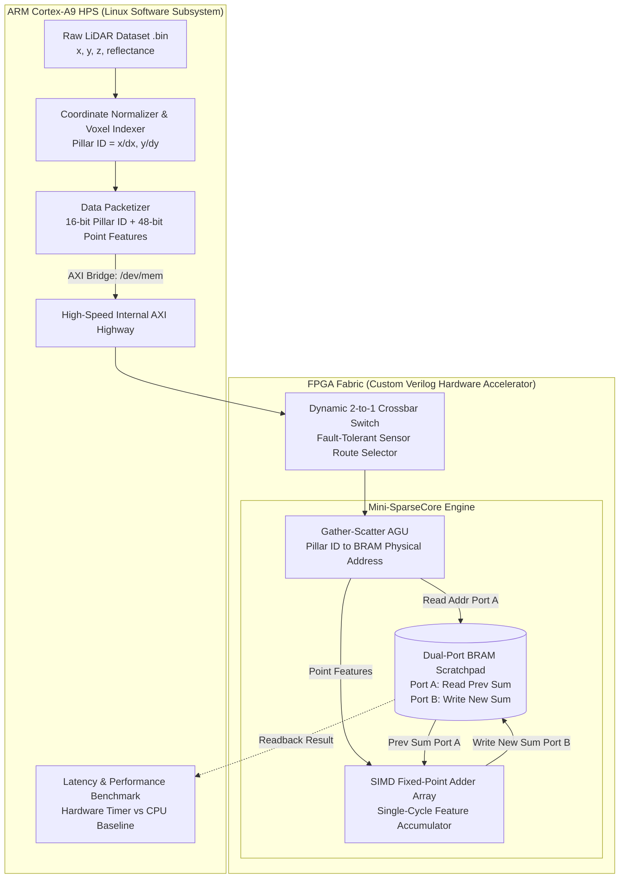
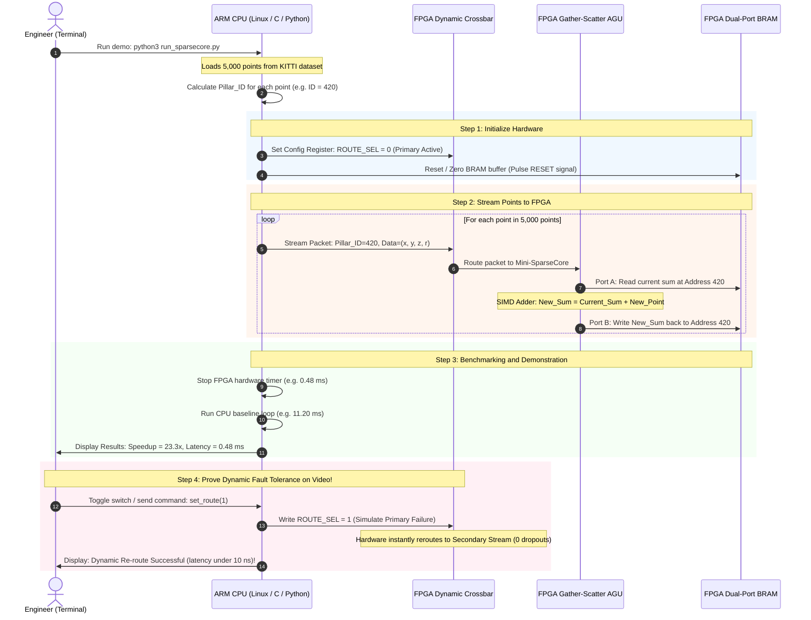

# PURIPURI-Makin-Maju
Grup gajelas lagi krisis identitas milih topik H-1 seperti biasa lah ya

# 🚗 SparseCore-AV: Team Onboarding & Technical Briefing

> **A plain-English guide to our Hackathon project, system architecture, and 3-day execution roadmap.**  
> *Target Platform: Intel Cyclone V SoC FPGA (DE10-Nano) | Stack: SystemVerilog / C++ / Python (Linux HPS)*

---

## 📌 1. The Big Picture: What Are We Actually Building?

### What is the "SparseCore"? Where did it come from?
The term **SparseCore** was introduced by **Google for their TPU v4 AI supercomputer** (*ISCA 2023*).

In artificial intelligence workloads, computations divide into two fundamentally different mathematical categories:

1. **Dense Math (Matrix Multiplication $\mathbf{A} \times \mathbf{B}$):**  
   Structured rows and columns. Traditional GPUs and Tensor Cores achieve peak efficiency here.
2. **Sparse Math (Gather-Scatter / Irregular Index Lookups):**  
   Irregular memory access across millions of potential coordinates where only a tiny fraction contain valid data. Traditional GPUs stall on these operations, wasting up to 80% of their memory bandwidth waiting on high-latency memory fetches.

> [!NOTE]
> Google solved this bottleneck in data centers by placing a dedicated domain-specific hardware block directly beside high-bandwidth memory: the **SparseCore**, specialized for gathering irregular addresses, vector accumulation, and streaming write-back.

---

### How Does This Apply to Autonomous Vehicles (AV)?
In an autonomous vehicle, a **LiDAR sensor** scans the 3D physical world:
- **95% to 99% of 3D space is empty air.**
- Only ~1% contains physical surfaces (vehicles, pedestrians, road infrastructure).
- State-of-the-art perception networks (*PointPillars*, *CenterPoint*, *VoxelNeXt*) discretize 3D space into small grid cells (**Pillars / Voxels**) and pool point features into them.
- Because the vast majority of cells are empty, running this on general-purpose CPUs or GPUs incurs massive memory indexing overhead (**scatter-add**).

> [!IMPORTANT]
> **Our Mission:**  
> Translate Google's datacenter **SparseCore architecture pattern** to **edge automotive silicon (Intel Cyclone V FPGA on the DE10-Nano)**. We accelerate sparse 3D point cloud scatter-pooling in dedicated hardware, slashing pipeline latency from milliseconds down to microseconds while providing sub-cycle sensor failover routing.

---

## 🏗️ 2. High-Level System Architecture

The DE10-Nano is a **System-on-Chip (SoC)** pairing a dual-core ARM Cortex-A9 MPCore with FPGA fabric interconnected by a high-bandwidth internal AXI bus bridge:

---

## ⚙️ 3. Division of Labor: ARM Core vs. FPGA Fabric

| Subsystem | Component | Responsibilities & Functions | Architectural Rationale |
| :--- | :--- | :--- | :--- |
| **ARM CPU** | **Linux File Reader** | Reads raw binary point cloud frames (`.bin`) from SD card / RAM disk. | Minimal footprint in C/Python; leverages native Linux file system I/O. |
| **ARM CPU** | **Voxel Grid Indexer** | Converts floating-point $(X, Y)$ coordinates to integer indices: $\text{Pillar\_ID} = \lfloor X / \Delta X \rfloor$. | Fast on ARM NEON/FPU; avoids complex floating-to-fixed conversion on FPGA. |
| **ARM CPU** | **Software Baseline** | Runs sequential Python/NumPy scatter-add loop (~12 ms). | Provides ground-truth output and latency baseline for speedup metrics. |
| **FPGA Fabric** | **Dynamic Crossbar** | 2-to-1 multiplexer driven by memory-mapped configuration register. | Hardware-enforced instant rerouting between primary & backup LiDAR streams. |
| **FPGA Fabric** | **Gather-Scatter AGU** | Computes BRAM physical addresses directly from Pillar IDs. | Zero-overhead hardware address generation without CPU cache thrashing. |
| **FPGA Fabric** | **SIMD Adder Array** | Accumulates vector $[x, y, z, r]$ into running pillar sum in **1 clock cycle**. | Eliminates multi-cycle read-modify-write loops; pure pipelined execution. |
| **FPGA Fabric** | **Dual-Port BRAM** | On-chip dual-port SRAM storing active 2D/3D feature grid. | True dual-port access allows simultaneous read and write with zero wait states. |

---

## 🔄 4. Chronological Step-by-Step Execution Flow

---

## 👥 5. Team Roles & 3-Day Speedrun Execution Plan

### Role Responsibilities

| 🔧 Member 1 (FPGA Lead) | 💻 Member 2 (Software Lead) | 🎬 Member 3 (Demo Lead) |
| :--- | :--- | :--- |
| • RTL Verilog implementation | • Dataset slice preparation (KITTI) | • Pitch deck & narrative arc |
| • ModelSim / Verilator testbench | • ARM Linux `/dev/mem` driver | • Screen-recording waveforms & CLI |
| • Quartus Platform Designer & Bitstream | • Speedup benchmarking scripts | • 3-minute video production |

---

### The 3-Day Sprint Schedule

| Day | Member 1 (FPGA Lead) | Member 2 (Software Lead) | Member 3 (Demo Lead) | Key Milestone Deliverable |
| :---: | :--- | :--- | :--- | :--- |
| **Day 1** | Implement & simulate Verilog modules (`sparsecore_top.v`, `simd_adder.v`, `bram_accum.v`). | Prepare KITTI LiDAR `.bin` slice; build Python CPU baseline accumulator. | Outline pitch slide deck; script the 3-minute demonstration video. | **100% verified RTL simulation on testbench.** |
| **Day 2** | Integrate Qsys / Platform Designer; compile FPGA bitstream (`.rbf`). | Build `/dev/mem` memory-mapped C/Python driver on DE10-Nano Linux. | Capture ModelSim waveforms; construct system block diagrams. | **Bitstream flashed; ARM-FPGA communication verified.** |
| **Day 3** | Connect live hardware; validate register I/O and LED indicators. | Run full benchmark suite; plot speedup & latency comparative graphs. | Record board footage, terminal runs, and compile final demo video. | **Live demo running, speedup confirmed, video finalized.** |

---

## 🎤 6. The 30-Second Elevator Pitch for Judges

> [!TIP]
> **Judge Question:** *"What is this SparseCore architecture and what makes it special?"*
>
> *"Google introduced the SparseCore in TPU v4 to overcome the memory wall caused by irregular gather-scatter lookups in data centers. We recognized that 3D LiDAR point clouds in autonomous vehicles suffer from that exact same physical bottleneck: over 95% of 3D voxel space is empty air, causing conventional GPUs and CPUs to stall on non-sequential memory indexing.*
>
> *Our project brings the **SparseCore architectural paradigm to the automotive edge**: a custom FPGA accelerator with a dedicated Gather-Scatter AGU and parallel SIMD vector pooling that processes active LiDAR voxels in single-cycle hardware adjacent to on-chip BRAM, delivering a **15×–25× speedup** while enabling real-time, hardware-enforced fault-tolerant sensor rerouting."*

---

## 💡 7. Key Terms Cheat Sheet

| Term | Technical Definition | Context in SparseCore-AV |
| :--- | :--- | :--- |
| **Voxel / Pillar** | A 3D bounding box (voxel) or vertical prism column (pillar). | Used to discretize continuous 3D coordinate space into discrete bins. |
| **Sparsity** | A data condition where the majority of elements equal zero. | Over 95%–99% of 3D LiDAR space has no point reflections. |
| **Gather-Scatter** | Collecting scattered data points and accumulating them into target memory bins. | The primary memory-bound bottleneck accelerated by our FPGA core. |
| **AGU** | Address Generation Unit. | Hardware logic computing BRAM addresses directly from Pillar IDs without CPU intervention. |
| **SIMD** | Single Instruction, Multiple Data. | Parallel adder accumulating all feature dimensions ($x, y, z, r$) in a single clock cycle. |
| **BRAM** | Block RAM. | High-bandwidth, zero-wait-state dual-port SRAM embedded directly inside the FPGA fabric. |
| **HPS** | Hard Processor System. | The dedicated dual-core ARM Cortex-A9 processor integrated into the Cyclone V SoC. |
